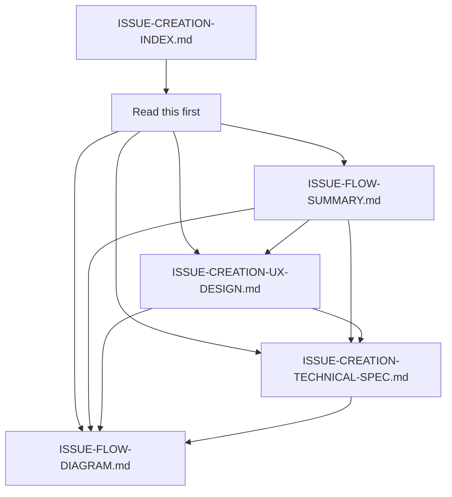

# Issue Creation Design - Index

**Status:** Complete  
**Owner:** @bailey  
**Created:** 2026-10-14  
**Purpose:** Central index for all issue creation flow documentation

---

## Overview

This index document organizes all the design work for the **spec-aware issue creation flow** in Beehive. The design solves the core problem: **the current UI expects humans to write spec JSON in free-form text fields, which is unreasonable.**

---

## Document Map

```
┌─────────────────────────────────────────────────────────────────┐
│ ISSUE CREATION DESIGN DOCUMENTS                                 │
├─────────────────────────────────────────────────────────────────┤
│                                                                     │
│  THIS FILE                                                        │
│  ISSUE-CREATION-INDEX.md ────────────────── You are here          │
│                                                                     │
│  📖 CORE DOCUMENTS                                               │
│  ├─ ISSUE-FLOW-SUMMARY.md ──────────────── Executive overview     │
│  │   └── Quick start, benefits, metrics, file list               │
│  │                                                               │
│  ├─ ISSUE-CREATION-UX-DESIGN.md ───────────── User experience    │
│  │   ├── Problem statement                                        │
│  │   ├── Design goals                                            │
│  │   ├── User personas                                           │
│  │   ├── Detailed flow (6 phases)                                 │
│  │   ├── Flow variations                                          │
│  │   ├── Structured contract editor                               │
│  │   ├── API design                                               │
│  │   ├── UI component library                                    │
│  │   ├── Success metrics                                          │
│  │   └── Open questions                                          │
│  │                                                               │
│  ├─ ISSUE-CREATION-TECHNICAL-SPEC.md ──────────── Technical     │
│  │   ├── API endpoint specifications (5 new endpoints)           │
│  │   ├── Algorithm implementations (3 modules)                    │
│  │   ├── Database schema changes (1 new table, 3 new columns)    │
│  │   ├── Spec DO integration                                       │
│  │   ├── Frontend integration                                      │
│  │   ├── CLI integration                                           │
│  │   ├── Testing strategy                                          │
│  │   ├── Performance considerations                                 │
│  │   ├── Security considerations                                   │
│  │   └── Deployment checklist                                      │
│  │                                                               │
│  └─ ISSUE-FLOW-DIAGRAM.md ─────────────────────── Visual flows   │
│      ├── Main flow diagram                                         │
│      ├── Decision tree                                             │
│      ├── State machine                                             │
│      ├── Component flow                                            │
│      ├── Data flow                                                 │
│      ├── Error handling flow                                       │
│      ├── Duplicate detection flow                                  │
│      ├── Spec matching flow                                        │
│      ├── Agent flow                                                │
│      ├── Quick reference                                            │
│      ├── Timing diagram                                             │
│      └── Legend                                                    │
│                                                                     │
└─────────────────────────────────────────────────────────────────┘
```

---

## Reading Guide

### For Executives / Quick Review
**Start with:** [ISSUE-FLOW-SUMMARY.md](ISSUE-FLOW-SUMMARY.md)  
**Time:** 5-10 minutes  
**Covers:** Problem, solution overview, benefits, metrics, high-level timeline

### For Product Managers / Designers
**Start with:** [ISSUE-CREATION-UX-DESIGN.md](ISSUE-CREATION-UX-DESIGN.md)  
**Then:** [ISSUE-FLOW-DIAGRAM.md](ISSUE-FLOW-DIAGRAM.md)  
**Time:** 20-30 minutes  
**Covers:** User experience, flow details, personas, UI components, edge cases

### For Engineers / Implementers
**Start with:** [ISSUE-FLOW-SUMMARY.md](ISSUE-FLOW-SUMMARY.md)  
**Then:** [ISSUE-CREATION-TECHNICAL-SPEC.md](ISSUE-CREATION-TECHNICAL-SPEC.md)  
**Then:** [ISSUE-FLOW-DIAGRAM.md](ISSUE-FLOW-DIAGRAM.md)  
**Time:** 40-60 minutes  
**Covers:** Technical details, APIs, algorithms, database, integration points

### For Visual Learners
**Start with:** [ISSUE-FLOW-DIAGRAM.md](ISSUE-FLOW-DIAGRAM.md)  
**Then:** [ISSUE-FLOW-SUMMARY.md](ISSUE-FLOW-SUMMARY.md)  
**Time:** 10-15 minutes  
**Covers:** Flow diagrams, state machines, decision trees

---

## Quick Reference

### The Problem
- Current UI expects humans to write spec JSON in free-form text fields
- No duplicate detection
- No spec suggestions
- Issues and specs are disconnected

### The Solution
- Spec-aware, agent-assisted issue creation flow
- Intelligent duplicate detection
- Automatic spec suggestions
- Structured contract editor (no manual JSON)
- Proper spec linking

### Key Metrics
| Metric | Current | Target | Improvement |
|--------|---------|--------|-------------|
| Issue creation time (with spec) | ~10-15 min | < 2 min | 85% faster |
| JSON error rate | ~30% | < 5% | 83% reduction |
| Duplicate rate | ~20% | < 10% | 50% reduction |
| Spec link rate | ~10% | > 60% | 500% increase |

### Key Features
1. ✅ Intent detection from issue text
2. ✅ Duplicate detection with similarity scoring
3. ✅ Spec suggestions with confidence scores
4. ✅ Structured contract editor (no JSON writing)
5. ✅ Delta surface editor with predefined categories
6. ✅ Partial spec extraction from issue description
7. ✅ Automatic spec linking
8. ✅ Support for both human and agent workflows

### Files to Modify
**Backend:** 8 files (5 new, 3 modified)  
**Frontend:** 3 files (1 new, 2 modified)  
**CLI:** 1 file (modified)

### Implementation Phases
1. **Phase 1:** Backend Services (2-3 days) - M4 deadline
2. **Phase 2:** Frontend UI (3-5 days) - M4+1
3. **Phase 3:** Agent Support (1-2 days) - M4+1
4. **Phase 4:** Polish & Learning (2-3 days) - M4+2

---

## Document Details

### 📄 ISSUE-FLOW-SUMMARY.md
**Purpose:** Executive summary and quick reference  
**Audience:** Executives, stakeholders, anyone needing a quick overview  
**Length:** ~5 minutes read  
**Includes:**
- Problem statement
- Solution overview
- User flow examples
- Key features
- Technical architecture (high-level)
- Implementation plan
- Success metrics
- Benefits for each user type
- Before/after comparison
- Files to modify
- FAQ

**Best for:** Understanding what we're building and why

---

### 📄 ISSUE-CREATION-UX-DESIGN.md
**Purpose:** Comprehensive user experience design  
**Audience:** Product managers, UX designers, frontend engineers  
**Length:** ~20 minutes read  
**Includes:**
- Current problems (detailed)
- Design goals (primary and secondary)
- User personas (4 types)
- 6-phase user flow:
  1. Intent Detection
  2. Duplicate Detection
  3. Spec Suggestions
  4. Spec Selection or Creation
  5. Spec Validation & Preview
  6. Submission & Confirmation
- Flow variations:
  - Quick issue flow (no spec)
  - Agent flow (programmatic)
  - Partial spec from issue
- Structured Contract Editor design
- API design overview
- UI component library (8 components)
- Data model changes
- Implementation phases
- Success metrics
- Open questions
- Example sessions

**Best for:** Understanding how users will interact with the system

---

### 📄 ISSUE-CREATION-TECHNICAL-SPEC.md
**Purpose:** Detailed technical implementation guide  
**Audience:** Backend engineers, full-stack engineers, technical leads  
**Length:** ~30 minutes read  
**Includes:**
- 5 new API endpoints with full specs:
  1. GET /api/issues/similar
  2. GET /api/specs/suggest
  3. POST /api/specs/extract
  4. POST /api/specs/validate
  5. POST /api/issues (enhanced)
- 3 algorithm implementations:
  1. IssueSimilarityCalculator
  2. SpecMatcher
  3. SpecExtractor
- Database schema changes:
  - New table: issue_creation_suggestions
  - Modified table: issues (3 new columns)
  - New indexes (4)
- Spec DO integration code
- Frontend integration points
- CLI integration code
- Testing strategy with examples
- Performance considerations
- Security considerations
- Deployment checklist

**Best for:** Implementing the solution

---

### 📄 ISSUE-FLOW-DIAGRAM.md
**Purpose:** Visual representation of all flows  
**Audience:** Visual learners, architects, designers, anyone presenting the design  
**Length:** ~15 minutes to review all diagrams  
**Includes:**
- Main flow diagram (complete end-to-end)
- Decision tree (how decisions are made)
- State machine (system states)
- Component flow (UI component hierarchy)
- Data flow (information flow through system)
- Error handling flow
- Duplicate detection flow (detailed)
- Spec matching flow (detailed)
- Agent flow (simplified)
- Quick reference (timing for different scenarios)
- Key decisions visualized:
  - When to suggest spec creation
  - Relationship type suggestion
  - Stage assignment logic
- Timing diagram (Gantt chart)
- Legend (Mermaid symbols explained)

**Best for:** Understanding the system at a glance, presentations, documentation

---

## How These Documents Work Together



**Recommended Reading Paths:**

1. **Executive Path:** INDEX → SUMMARY
2. **Product Path:** INDEX → SUMMARY → UX-DESIGN → DIAGRAM
3. **Engineering Path:** INDEX → SUMMARY → TECHNICAL-SPEC → DIAGRAM
4. **Visual Path:** INDEX → DIAGRAM → SUMMARY → (UX-DESIGN or TECHNICAL-SPEC based on interest)

---

## Version Information

| Document | Version | Last Updated | Author |
|----------|---------|--------------|--------|
| ISSUE-CREATION-INDEX.md | 1.0 | 2026-10-14 | @bailey |
| ISSUE-FLOW-SUMMARY.md | 1.0 | 2026-10-14 | @bailey |
| ISSUE-CREATION-UX-DESIGN.md | 1.0 | 2026-10-14 | @bailey |
| ISSUE-CREATION-TECHNICAL-SPEC.md | 1.0 | 2026-10-14 | @bailey |
| ISSUE-FLOW-DIAGRAM.md | 1.0 | 2026-10-14 | @bailey |

---

## Feedback & Contributions

**Have questions or feedback?**
- Open an issue in the repository
- Tag @bailey for design questions
- Tag engineering leads for implementation questions

**Want to contribute?**
- See implementation phases in TECHNICAL-SPEC
- Pick up tasks from Phase 1 (highest priority)
- Review open questions in UX-DESIGN

---

## Related Documents

**Existing Beehive Documentation:**
- [AGENTS.md](../AGENTS.md) - Agent working conventions
- [ARCHITECTURE.md](ARCHITECTURE.md) - System architecture
- [UI-DASHBOARD-PLAN.md](UI-DASHBOARD-PLAN.md) - Dashboard design
- [MILESTONES.md](MILESTONES.md) - Project milestones

**External References:**
- [Mermaid Syntax](https://mermaid.js.org/) - For diagram formatting
- [Cloudflare Workers](https://developers.cloudflare.com/workers/) - Platform docs
- [Durable Objects](https://developers.cloudflare.com/workers/platform/durable-objects/) - Storage docs

---

## Quick Links

- [View all issue creation docs in GitHub](https://github.com/bailey-coding/beehive-meta-notes/tree/main/docs)
- [Create an issue](https://github.com/bailey-coding/beehive-meta-notes/issues/new)
- [Back to docs index](../README.md)

---

*This index is the starting point for all issue creation flow design work in Beehive.*
