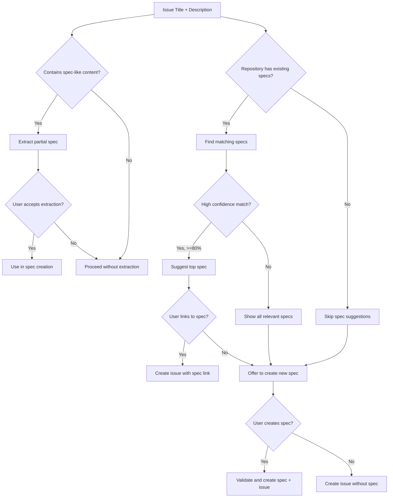
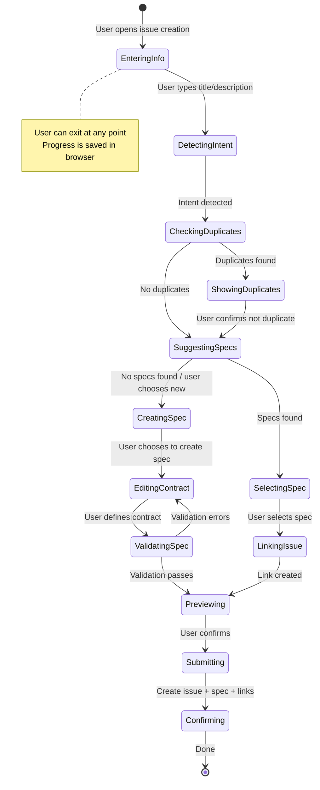
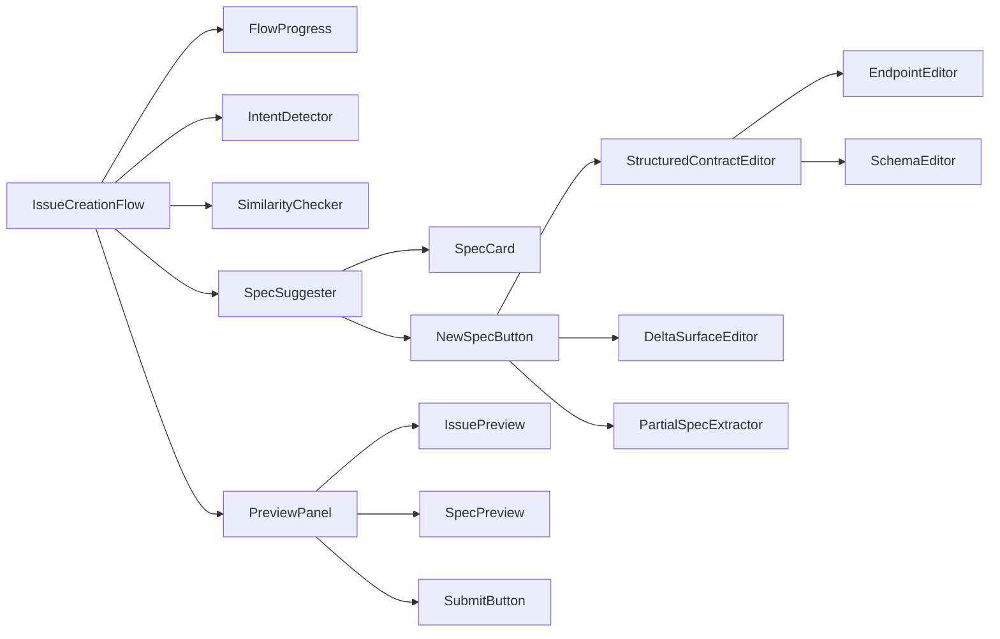
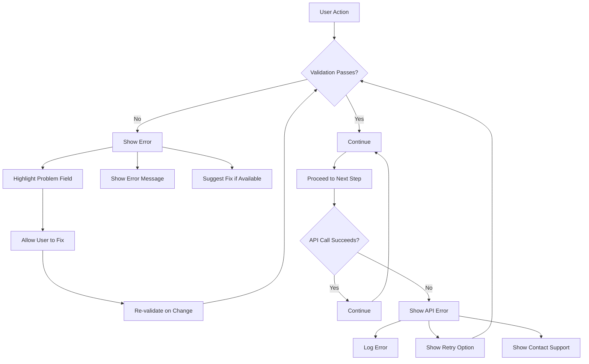
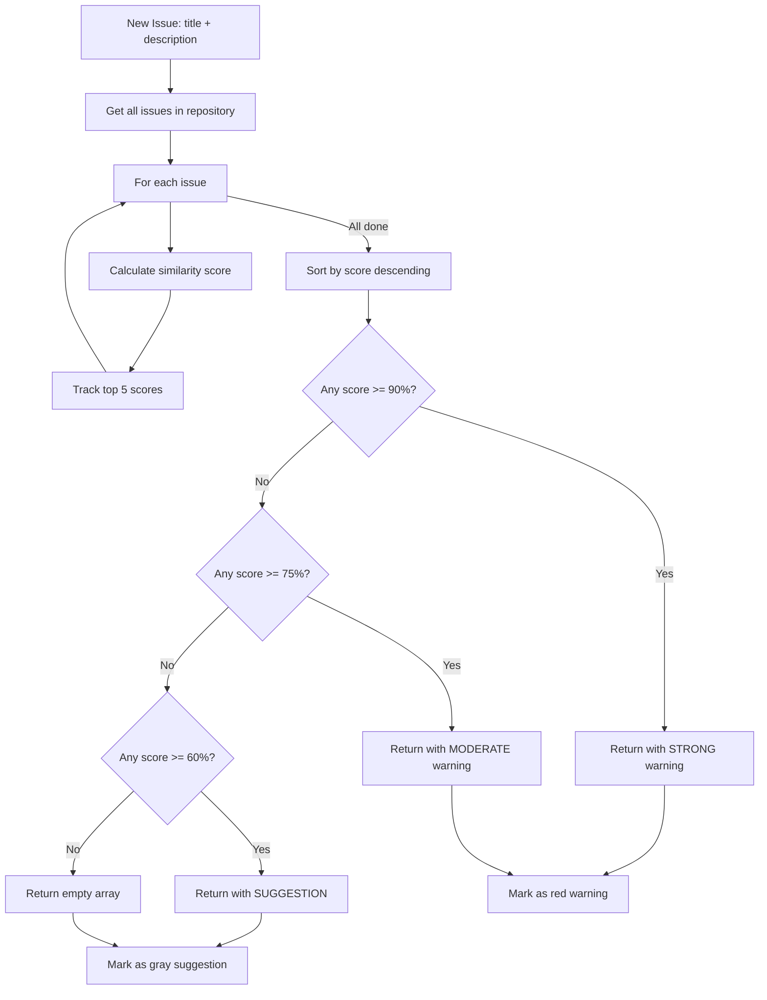
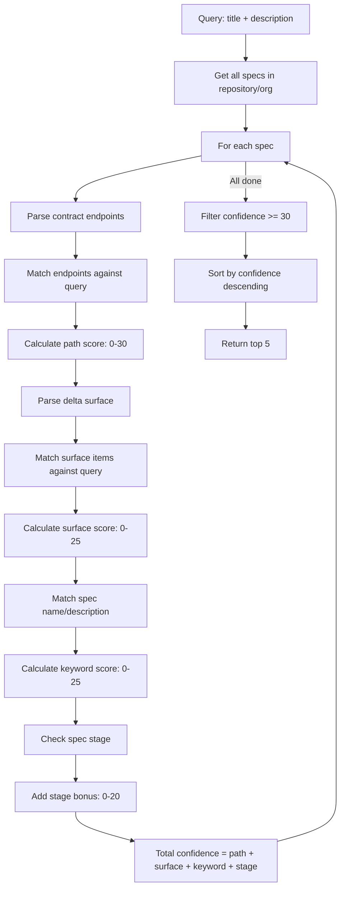
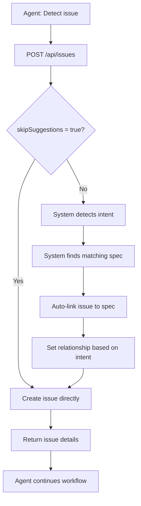
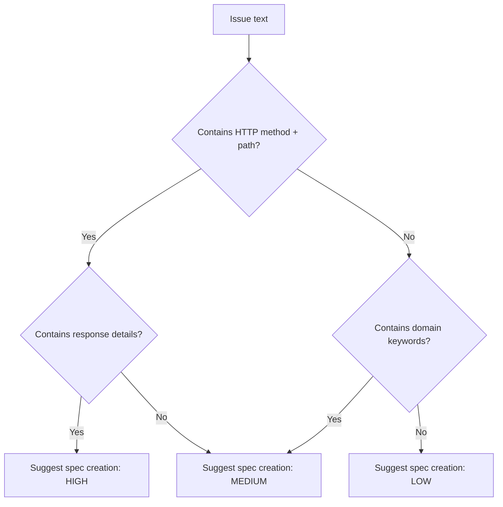
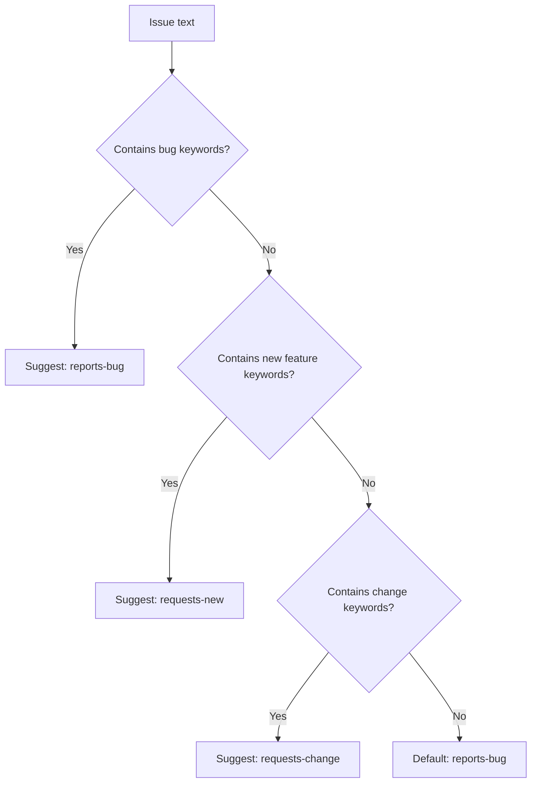
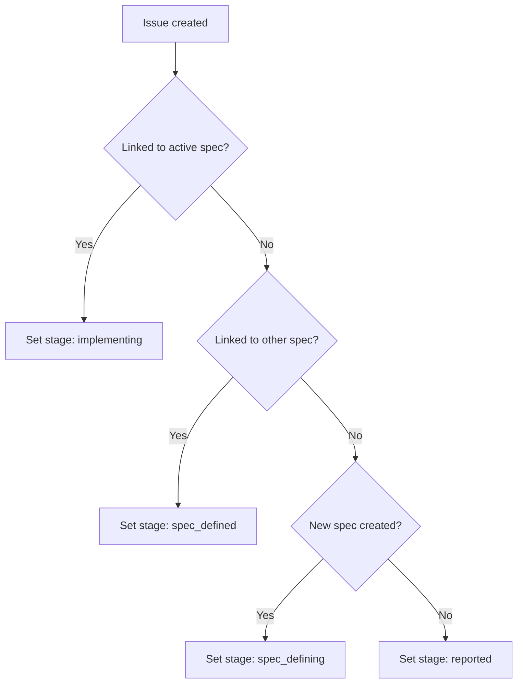

# Issue Creation Flow - Visual Diagram

**Status:** Design Complete  
**Owner:** @bailey  
**Created:** 2026-10-14  
**Format:** Mermaid diagrams for visualization

---

## Main Flow Diagram

```mermaid
graph TD
    A[START: User navigates to /app/issues/new] --> B[Enter Title & Description]
    B --> C[Intent Detection: Analyze text in real-time]
    C --> D{Intent Detected?}
    D -->|Yes| E[Classify: bug_report, feature_request, etc.]
    D -->|No| B
    E --> F[Extract Entities: methods, paths, status codes]
    F --> G[Check for Duplicates]
    G --> H{Similar Issues Found?}
    H -->|Yes, >=90%| I[Show Strong Duplicate Warning]
    H -->|Yes, >=75%| J[Show Moderate Duplicate Warning]
    H -->|Yes, >=60%| K[Show Suggested Reading]
    H -->|No| L[No duplicates found]
    I --> M[User: Confirm not duplicate or view issue]
    J --> M
    K --> M
    M --> N[Find Spec Matches]
    L --> N
    N --> O{Spec Matches Found?}
    O -->|Yes| P[Show Spec Suggestions with confidence scores]
    O -->|No| Q[Offer: "This issue requires a NEW spec"]
    P --> R[User selects spec or "Create New"]
    Q --> R
    R -->|Link to existing| S[Link Issue to Spec]
    R -->|Create new| T[Open Structured Spec Editor]
    S --> U[Set Relationship: reports-bug, requests-new, requests-change]
    T --> V[User defines contract & delta surface]
    V --> W[Validate spec]
    W -->|Invalid| X[Show errors, allow fixes]
    W -->|Valid| Y[Preview issue + spec]
    X --> V
    Y --> Z[User reviews and submits]
    Z --> AA[Create issue with spec links]
    AA --> AB[Set appropriate stage]
    AB --> AC[Show confirmation]
    AC --> AD[DONE]
    
    U --> Y
```

---

## Decision Tree



---

## State Machine



---

## Component Flow



---

## Data Flow

```mermaid
flowchart TD
    subgraph UserInput
        A[Title Input] --> B[Description Input]
        B --> C[Repository Selector]
        C --> D[Labels Input]
    end
    
    subgraph SystemProcessing
        D --> E[Intent Detection Algorithm]
        E --> F[Entity Extraction]
        F --> G[Duplicate Detection]
        G --> H[Spec Matching]
        H --> I[Partial Spec Extraction]
        I --> J[Spec Validation]
    end
    
    subgraph APICalls
        E -->|POST| K[/api/specs/extract]
        G -->|GET| L[/api/issues/similar]
        H -->|GET| M[/api/specs/suggest]
        I -->|POST| N[/api/specs/extract]
        J -->|POST| O[/api/specs/validate]
        Submit -->|POST| P[/api/issues]
    end
    
    subgraph Storage
        P --> Q[Spec DO: issues table]
        P --> R[Spec DO: issue_spec_links table]
        P --> S[Spec DO: specs table]
        P --> T[Spec DO: issue_creation_suggestions table]
    end
    
    UserInput --> SystemProcessing
    SystemProcessing --> APICalls
    APICalls --> Storage
```

---

## Error Handling Flow



---

## Duplicate Detection Flow



---

## Spec Matching Flow



---

## Agent Flow (Simplified)



---

## Quick Reference: Flow Steps

### Full Spec Creation Flow (All Steps)
1. **Enter Info** - User types title, description, selects repository
2. **Detect Intent** - System analyzes text (2s)
3. **Check Duplicates** - System finds similar issues (2s)
4. **User Confirms** - Not a duplicate (1s)
5. **Suggest Specs** - System finds matching specs (3s)
6. **Select "Create New"** - User chooses to create new spec (1s)
7. **Define Contract** - User uses structured editor (2-3 min)
8. **Define Delta Surface** - User selects categories (1 min)
9. **Validate** - System checks spec (1s)
10. **Preview** - User reviews (30s)
11. **Submit** - System creates issue + spec + links (2s)
12. **Confirm** - Show success (1s)

**Total: 4-6 minutes for complex spec creation**

### Quick Issue Flow (Minimal Steps)
1. **Enter Info** - User types title, description
2. **Detect Intent** - System analyzes (2s)
3. **Check Duplicates** - None found (2s)
4. **Suggest Specs** - System finds match (3s)
5. **Link to Spec** - User selects spec (1s)
6. **Submit** - System creates issue (2s)
7. **Confirm** - Show success (1s)

**Total: 15-20 seconds for spec-linked issue**

### Simple Issue Flow (No Spec)
1. **Enter Info** - User types title, description
2. **Detect Intent** - System analyzes (2s)
3. **Check Duplicates** - None found (2s)
4. **Suggest Specs** - No matches (3s)
5. **Skip Spec** - User chooses not to link (1s)
6. **Submit** - System creates issue (2s)
7. **Confirm** - Show success (1s)

**Total: 10-15 seconds for simple issue**

---

## Key Decisions Visualized

### When to Suggest Spec Creation


### Relationship Type Suggestion


### Stage Assignment


---

## Timing Diagram

```mermaid
gantt
    title Issue Creation Timing
    dateFormat  X
    section User Actions
    Type title/desc      :a1, 20s
    Review suggestions    :after a1, 15s
    Define spec          :after a1, 180s
    Review & submit      :after a1, 30s
    
    section System Processing
    Intent detection     :b1, 2s
    Duplicate check      :b2, after b1, 2s
    Spec suggestions     :b3, after b2, 3s
    Spec validation      :b4, after a1, 1s
    
    section Network
    API calls            :c1, 0.5s
    DB queries           :c2, 0.3s
```

---

## Legend

```
┌─────────────────────────────────────────────────────────────────┐
│ MERMAID SYMBOLS USED IN DIAGRAMS                                  │
├─────────────────────────────────────────────────────────────────┤
│                                                                     │
│  []     Rectangle    = Process/Action                            │
│  {}     Diamond     = Decision point                            │
│  ()     Subroutine  = Sub-process                                │
│  -->    Arrow       = Flow direction                            │
│  -->|   Conditional = Flow with label                            │
│  *     Start/End    = Beginning or end of flow                     │
│  note   Annotation  = Additional information                      │
│                                                                     │
│  In state diagrams:                                               │
│  [*]              = Start state                                  │
│  -->             = Transition                                     │
│  note right of   = Annotation on right                           │
│                                                                     │
└─────────────────────────────────────────────────────────────────┘
```

---

## How to Use These Diagrams

1. **For Implementation**: Use the main flow diagram to understand the sequence
2. **For Debugging**: Use the error handling flow to trace issues
3. **For Onboarding**: Use the quick reference to explain the flow
4. **For Planning**: Use the timing diagram to estimate effort

---

## Related Documents

- [ISSUE-CREATION-UX-DESIGN.md](ISSUE-CREATION-UX-DESIGN.md) - Detailed UX design
- [ISSUE-CREATION-TECHNICAL-SPEC.md](ISSUE-CREATION-TECHNICAL-SPEC.md) - Technical implementation
- [ISSUE-FLOW-SUMMARY.md](ISSUE-FLOW-SUMMARY.md) - Executive summary

---

*Mermaid diagrams can be rendered in GitHub, VS Code with Mermaid plugin, or at [mermaid.live](https://mermaid.live)*
